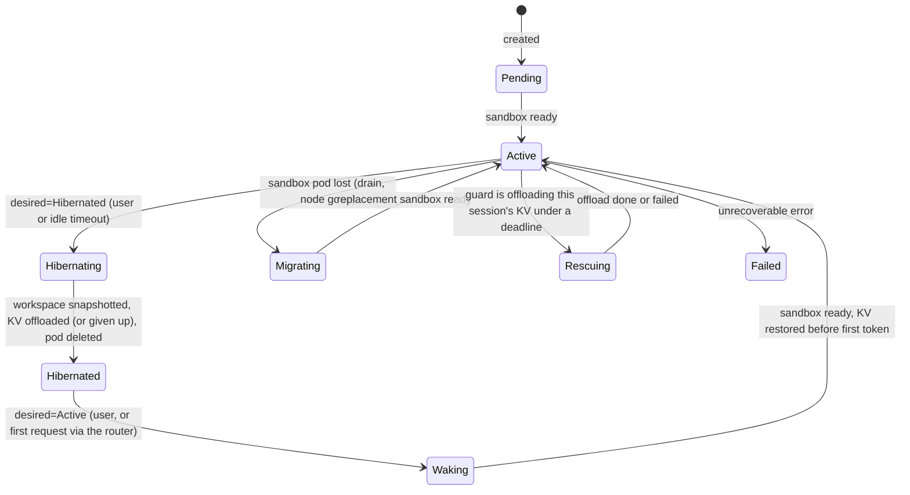

# Anton Platform: design

This document explains why Anton is built the way it is: the problem, the
state machine, the four decisions that make up its core, how it fails, and how
the benchmark keeps the comparison fair. The README covers what it is and how
to run it.

## 1. Problem

An AI coding agent holds expensive state in two places:

1. **The sandbox**: files it wrote, a git checkout, a terminal. Lose it and the work is gone.
2. **The KV cache** on an inference replica: the model's already-computed
   attention keys and values for the whole conversation. Lose it and the next
   request pays a full prefill: seconds of GPU time that grow with context
   length (40k tokens on a 7B model is several GPU-seconds per request).

Kubernetes treats pods as disposable and every pod as equal. A node drain, a
spot interruption, Karpenter consolidation, a replica scale-down or scale-to-zero
destroys both kinds of state, and the scheduler has no way to know that one
replica holds 40k tokens of hot context while another holds nothing.

Existing pieces each cover part of this. Agent Sandbox keeps the sandbox but
knows nothing about the model's context. llm-d routes requests to the replica
holding a prefix but does not choose which replica to remove or rescue a cache
before a node dies. LMCache moves KV blocks between tiers but is not wired to
Kubernetes disruption events or agent identity. **Anton's contribution is one
lifecycle for both kinds of state, with disruption-time decisions made by a
cost model.**

## 2. Design rule: agents do not own GPUs

Sandboxes are CPU pods. They call a shared pool of inference replicas through
the session router. This separation makes the problem tractable:

- the sandbox is ordinary filesystem state: snapshotted with VolumeSnapshots
  (or tarballs to the cache tier on clusters without snapshot support);
- the GPU-side state that matters, the KV cache, moves through the cache
  tier (LMCache in the real stack) instead of trying to checkpoint GPU processes.

## 3. The AgentSession state machine

One custom resource owns a session's sandbox and its KV-cache identity.
`spec.desiredState` (Active or Hibernated) is what a user or the idle detector
asks for; `status.phase` is what the operator has achieved.

Rules the operator follows in every transition:

- **Fail to recompute.** A failed KV offload or restore never blocks a drain,
  a hibernation or a request. The session pays the prefill and continues.
- **Hibernation is resumable.** A VolumeSnapshot can take many reconciles to
  become ready, so each step is idempotent and the expensive ones run once
  per hibernation (the snapshot is named after the hibernation count).
- **A snapshot that never becomes ready does not block hibernation.** After
  `SnapshotTimeout` the pod is stopped and the volume is kept instead of
  deleted, so nothing is lost.
- **Rescuing is owned by the guard.** The reconciler never moves a session
  out of Rescuing; the guard sets it back when its offload ends.

## 4. The four core decisions

All four live in `internal/planner` as pure functions with unit tests, separate
from the Kubernetes code that calls them.

### 4.1 Offload or recompute

Moving a session's KV cache is worth it only if

    offload_time(bytes) + restore_time(bytes) < prefill_time(tokens)

with all three rates measured on real hardware (`bench/calibration.json`, and
`bench/vllm_lmcache_calibrate.ipynb` for vLLM + LMCache). Bytes grow linearly
with tokens, but prefill grows faster than linearly with context (attention is
quadratic), so the rule says "move long contexts, recompute short ones". The
crossover point depends on the model, GPU and network; the rule is evaluated
per session with the measured rates rather than as a fixed token threshold.

*Alternative rejected:* a fixed context-length threshold. It is simpler, but
wrong as soon as the model, GPU or tier bandwidth changes.

### 4.2 Cache value (victim selection)

A cache entry is worth `P(reuse) × prefill_seconds_avoided`, where
`P(reuse) = 0.5^(age / half_life) × (0.5 + 0.5 × hits / (hits + 1))`:
exponential decay since last use, raised by how often the prefix has been
reused. A replica's score is the sum over its sessions. The guard writes it as
`controller.kubernetes.io/pod-deletion-cost`, so when the replica Deployment
scales down Kubernetes removes the lowest-value replica first. This needs no
change to Kubernetes, the HPA or Karpenter: it uses an annotation the
ReplicaSet controller already honours.

*Trade-off:* the half-life (default 5 minutes, `--half-life`) encodes how
long an idle agent is likely to come back. Too short and long-thinking agents
are treated as cold; too long and abandoned sessions protect replicas.

### 4.3 Rescue under a deadline

A spot notice gives a deadline (two minutes on AWS; the benchmark also uses
10 s to force triage). Offloads from one replica share its outbound
bandwidth, so the deadline is a **byte budget**: a 0/1 knapsack with
`value = net prefill seconds saved` and `weight = bytes to move`.

Anton serves higher priority tiers first, then picks greedily by value per
byte inside a tier (`PlanGreedy`), and only considers sessions that pass the
offload-or-recompute rule. An exact dynamic-programming knapsack (`PlanDP`)
is kept as the yardstick: across 200 random cases greedy reached at least
69% of the optimum. Greedy wins in practice because it runs in microseconds
when a deadline is ticking, and priority tiers are a product requirement the
pure optimum ignores.

Sessions the plan skips are released at once, so the router can move them
immediately instead of waiting for the deadline.

### 4.4 Affinity versus load (router)

The router keeps each session on the replica that holds its cache, and breaks
affinity only when

    expected_wait(current) > expected_wait(best_other) + prefill_time(context)

That is, when queueing behind other requests would cost more than recomputing
the whole context somewhere idle. Expected wait is queue depth times an
exponentially weighted average service time. A fixed queue-depth threshold
was rejected for the same reason as the fixed context threshold: the right
number depends on context length, so the rule compares costs instead.

## 5. Source of truth and consistency

Kubernetes owns **live** state (AgentSession spec and status). Postgres owns
**history, identity and billing**: users, teams, memberships, API keys,
quotas, templates, chat history, the lifecycle event log and the audit log.

- The API never writes live state to Postgres first. It writes the custom
  resource; the operator acts; the sync worker records what happened.
- The sync worker is idempotent: it skips an object whose `resourceVersion`
  it already stored, so replaying a watch or re-listing changes nothing.
- On disagreement the cluster wins. A relist marks rows whose resource is
  gone as deleted; the `sessions` table can be rebuilt from the cluster.
- Two logs, two questions. `lifecycle_events` records **what happened** to a
  session (observed in the cluster). `audit_log` records **who asked for
  what** (received by the API). Together with the cluster they reconstruct
  everything else.

## 6. Tenancy and security

- **Identity:** Google OAuth (authorization-code flow, server-side code
  exchange, verified email only) or a development login for local clusters.
  Every request carries a bearer key bound to one user acting in one team;
  only SHA-256 hashes of keys are stored.
- **Teams:** the first person into a new team becomes its owner; joining an
  existing team with Google needs an owner's invitation. Owners manage
  members, templates and the cluster mode, and read the audit log.
- **Quotas:** per team, total sessions and *active* sessions separately.
  Hibernated sessions count only toward the total, which makes hibernation
  the way a team stays under its active limit. Benchmark runs per day and
  API requests per minute (Redis-backed, fails open) are limited too.
- **Isolation (current):** every session lives in the `anton` namespace and
  tenancy is enforced in the API (every lookup filters by team; the event
  WebSocket filters on the recorded team, never on a name prefix).
- **Sandboxes run model-generated code**, so they are hardened: non-root,
  no privilege escalation, all capabilities dropped, RuntimeDefault seccomp,
  no service-account token, default-deny NetworkPolicy (ingress only from the
  operator and API; egress only to the cache tier, the router and DNS), and
  an optional RuntimeClass (`gvisor`).
- **Least privilege:** the operator, router, API and benchmark each have
  their own ServiceAccount and role. Only the benchmark may cordon nodes.

**Planned, not yet built:** a namespace per team with RBAC and
NetworkPolicies between teams. The operator and API address the `anton`
namespace by name today; moving to per-team namespaces is a contained
change (namespace from the team, a watch across namespaces) that has not
been made yet.

## 7. Failure modes

| Failure | What happens |
|---|---|
| Offload fails mid-drain | Session marked `cacheLocation=none`, message says so; next request recomputes. The drain is never delayed past its deadline. |
| Restore fails on wake | Router logs it and forwards anyway; the replica recomputes. |
| Replica vanishes with no notice | Guard sees the pod gone, releases its sessions (no cache to rescue); router re-places them. |
| Router sees a stale `status.replica` | It repairs the record to where it is actually serving the session. |
| Two copies of the operator | Leader election (Lease); standbys take over in about 15 s. The guard runs only on the leader, so two guards never plan rescues for the same replica. |
| Two copies of the router | Prevented by `Recreate` strategy; placement lives in memory and in session status. |
| VolumeSnapshot never ready | Hibernation completes after a timeout and keeps the volume. |
| Postgres down | API errors; the cluster keeps running sessions; the sync worker relists when Postgres returns. |
| Redis down | Rate limiting fails open. |
| Sandbox hard-killed (spot) | Workspace restored from the latest periodic snapshot (at most ~10 s of work lost in tarball mode). |

## 8. Benchmark design

The benchmark (`cmd/bench`) runs the same seeded workload in four modes, each
standing for one way of running agents today:

| Mode | Routing | Workspace survives pod loss | KV rescue / offload / restore | Stands for |
|---|---|---|---|---|
| `plain` | random | no | no | a plain Kubernetes Deployment + Service |
| `sandbox` | random | yes | no | Agent Sandbox alone |
| `routing` | cache affinity | no | no | llm-d-style routing alone |
| `anton` | cache affinity | yes | yes | the full system |

Each run applies four disruptions at fixed fractions of the load window: a
node drain through the Eviction API (the node returns after 30 s), a spot
interruption (notice, then force-delete), a consolidation (least-used worker,
evicted, never returns) and a replica scale-down (Kubernetes picks the victim,
guided by `pod-deletion-cost` in anton mode). Afterwards four sessions are
hibernated and woken by a request.

Fairness rules:

- **Same workload:** a seed fixes every session's starting context, growth and
  think times; every mode replays it.
- **Compare per request.** The load generator is closed-loop, so a slower
  mode sends fewer requests. Totals are not comparable; per-request GPU
  seconds and recomputed tokens are.
- **Lost state is counted, not inferred from latency.** A session lost its KV
  state if its first request after losing its replica found less than half
  its previous context cached. A sandbox lost its workspace if its workspace
  ID changed. Plain mode's resume latency can look good because random
  routing scatters partial caches everywhere; the counts expose that.
- **Several seeds** (`--seeds`): counts are summed across seeds, latency
  percentiles averaged, and per-seed GPU seconds per request are reported so
  the spread is visible.

## 9. Known limitations

See the README's Limitations section; the honest summary is that inference is
simulated with measured rates, the cluster is kind on one machine, and the
cache tier is in memory on a node the benchmark never disrupts.
